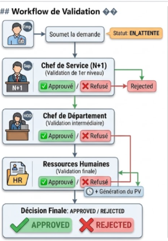
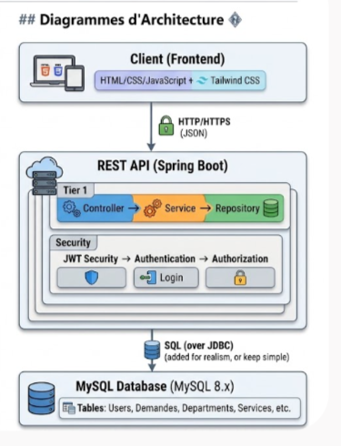

# Application de Gestion des Congés Administratifs

<div align="center">


</div>

---

## 📖 Table des matières

- [À propos](#-à-propos)
- [Contexte du projet](#-contexte-du-projet)
- [Fonctionnalités](#-fonctionnalités)
- [Workflow de validation](#-workflow-de-validation)
- [Architecture technique](#-architecture-technique)
- [Prérequis](#-prérequis)
- [Installation et lancement](#-installation-et-lancement)
- [Utilisation](#-utilisation)
- [Règles métier](#-règles-métier)
- [API REST](#-api-rest)
- [Tests](#-tests)
- [Troubleshooting](#-troubleshooting)
- [Documentation complète](#-documentation-complète)
- [Sécurité](#-sécurité)
- [Contribution](#-contribution)
- [Auteurs](#-auteurs)

---

## 📌 À propos

**Application Web de Gestion des Congés Administratifs (AGCA)** est une solution full-stack moderne développée dans le cadre d'un projet technique. Elle vise à **digitaliser et centraliser** la gestion des demandes de congés administratifs au sein d'une organisation.

### Caractéristiques principales

✅ **Authentification sécurisée** avec JWT  
✅ **Gestion du cycle de vie complet** des demandes (soumission → validation → archivage)  
✅ **Workflow hiérarchique** multi-niveaux  
✅ **Génération automatique de PV** (Procès-verbaux)  
✅ **Notifications par email** à chaque étape  
✅ **Interface responsive** adaptée à tous les appareils  
✅ **Audit complet** de toutes les actions  
✅ **Gestion de calendrier** (jours fériés, nationaux et religieux)

---

## 🎯 Contexte du projet

Ce projet a été réalisé dans le cadre d'un **stage technique** de DUT Génie Informatique à l'**Agence du Bassin Hydraulique de l'Oum Er-Rbia (ABHOER)** à Béni Mellal.

| Détail | Information |
|--------|-------------|
| **Période** | 04/04/2025 → 04/06/2025 |
| **Établissement** | EST Béni Mellal |
| **Commanditaire** | ABHOER (Agence du Bassin Hydraulique) |
| **Domaine** | Dématérialisation administrative |
| **Stratégie** | Maroc Digital 2025 |

> Ce projet répond aux recommandations de la DGME sur la dématérialisation des processus administratifs.

---

## 🚀 Fonctionnalités

### 👨‍💼 Employé

- ✅ Authentification sécurisée (JWT)
- ✅ Consultation du **solde de congés** (22 jours/an)
- ✅ Soumission d'une demande de congé (dates, motif, remplaçant)
- ✅ Modification / suppression d'une demande en attente
- ✅ Téléversement de documents justificatifs
- ✅ Consultation de l'historique personnel
- ✅ Suivi en temps réel du statut
- ✅ Visualisation du calendrier des jours fériés
- ✅ Statistiques personnelles (solde, approuvées, refusées)

### 👨‍💼 Chef de Service (N+1)

- ✅ Validation de premier niveau des demandes
- ✅ Vérification de la charge de travail
- ✅ Acceptation ou refus avec justification
- ✅ Consultation de la liste des employés
- ✅ Statistiques de son service

### 👨‍💼 Chef de Département/Division (N+2)

- ✅ Validation intermédiaire
- ✅ Consultation des services rattachés
- ✅ Transmission aux RH
- ✅ Statistiques par service
- ✅ Export Excel des données

### 🏢 Ressources Humaines (RH)

- ✅ **Validation finale** des demandes
- ✅ Gestion des soldes (année en cours + report)
- ✅ **Génération automatique du PV**
- ✅ Gestion des jours fériés
- ✅ Gestion des employés (CRUD)
- ✅ Statistiques RH globales
- ✅ Export Excel complet

### 🛡️ Administrateur

- ✅ Gestion complète des comptes utilisateurs
- ✅ Définition des rôles et permissions
- ✅ Gestion des départements et services
- ✅ Configuration du calendrier
- ✅ Tableau de bord avec statistiques
- ✅ Accès à l'historique complet
- ✅ Gestion du profil utilisateur

---

## 🔄 Workflow de validation

Le système suit un **workflow de validation en 3 niveaux** :



## 🏗️ Architecture technique



## ⚙️ Prérequis

Avant de commencer, assurez-vous d'avoir installé :

### Backend
- **Java Development Kit (JDK) 17+** → [Télécharger](https://www.oracle.com/java/technologies/downloads/)
- **Maven 3.8+** → [Télécharger](https://maven.apache.org/download.cgi)
- **Git** → [Télécharger](https://git-scm.com/)

### Base de données
- **MySQL 8.0+** → [Télécharger](https://www.mysql.com/downloads/)
- **OR XAMPP** (Apache + MySQL + phpMyAdmin) → [Télécharger](https://www.apachefriends.org/)

### Frontend
- **Navigateur moderne** (Chrome, Firefox, Safari, Edge)
- **VS Code / IntelliJ IDEA** (optionnel)

### Outils optionnels
- **Postman** → [Télécharger](https://www.postman.com/downloads/) (pour tester l'API)
- **Git GUI** → [GitHub Desktop](https://desktop.github.com/)

---

## 🛠️ Installation et lancement

### 1. Cloner le dépôt

```bash
git clone https://github.com/intissar-git/administrative-leave-management-app.git
cd administrative-leave-management-app
```

### 2. Backend (Spring Boot)

#### a) Créer la base de données

**Avec XAMPP :**

1. Démarrez XAMPP (Apache + MySQL)
2. Ouvrez phpMyAdmin : `http://localhost/phpmyadmin`
3. Créez une nouvelle base de données :

```sql
CREATE DATABASE gestion_conges_db 
CHARACTER SET utf8mb4 
COLLATE utf8mb4_unicode_ci;
```

**Avec MySQL CLI :**

```bash
mysql -u root -p

CREATE DATABASE gestion_conges_db 
CHARACTER SET utf8mb4 
COLLATE utf8mb4_unicode_ci;

EXIT;
```

#### b) Configuration du backend

La configuration du backend se fait via des variables d'environnement ou des fichiers de configuration. Les paramètres principaux incluent :

- **URL de la base de données** : ``
- **Identifiants MySQL** : Utilisateur et mot de passe
- **Port du serveur** : `8080`
- **Contexte API** : `/api`
- **Clé JWT** : Pour la sécurité des tokens
- **Configuration des emails** : Pour les notifications

#### c) Compiler et démarrer le backend

```bash
cd backend

# Nettoyer les builds précédents et installer les dépendances
mvn clean install

# Démarrer l'application
mvn spring-boot:run
```

Le backend sera accessible sur :
```
👉 http://localhost:8080/api
```

#### d) Vérifier l'état du backend

```bash
curl http://localhost:8080/api/health
```

### 3. Frontend (JavaScript +اhtml+css)

#### a) Naviguer vers le dossier frontend

```bash
cd ../frontend
```

#### b) Configurer l'URL de l'API

Éditer `js/config.js` et assurez-vous que l'URL de l'API est correcte :

```javascript
const API_URL = "http://localhost:8080/api";
```

#### c) Servir l'application  Avec Live Server (VS Code)**

1. Installez l'extension "Live Server" dans VS Code
2. Clic-droit sur `index.html` → "Open with Live Server"
3. Le navigateur s'ouvrira à `http://localhost:5500`


Le frontend sera accessible sur :
```
👉 http://localhost:5500 (ou l'adresse affichée)
```

---

## 🖥️ Utilisation

### Démarrage complet de l'application

1. **Démarrer MySQL/XAMPP**
   ```bash
   # Sur Windows, XAMPP Control Panel
   # Sur Linux/Mac
   mysql.server start
   ```

2. **Lancer le backend**
   ```bash
   cd backend
   mvn spring-boot:run
   ```

3. **Lancer le frontend**
   ```bash
   # Dans un nouvel onglet terminal
   cd frontend
   python -m http.server 5500
   # Ou avec Live Server
   ```

4. **Ouvrir le navigateur**
   ```
   http://localhost:5500
   ```

### Comptes de test

| Rôle | Email | Mot de passe |
|------|-------|-------------|
| Admin | admin@abhoer.ma | admin123 |
| RH | rh@abhoer.ma | rh123 |
| Chef Département | chef.dept@abhoer.ma | chef123 |
| Chef Service | chef.service@abhoer.ma | service123 |
| Employé | employe@abhoer.ma | emp123 |

⚠️ **Changez ces mots de passe avant toute utilisation en production !**

---

## 📏 Règles métier

| Règle | Détail |
|-------|--------|
| **Solde annuel** | 22 jours ouvrables par employé |
| **Calcul des jours** | Exclusion weekends (sam/dim) + jours fériés |
| **Niveaux de validation** | 3 niveaux (Service → Département → RH) |
| **Justification obligatoire** | Requise en cas de refus |
| **Remplaçant obligatoire** | Requis pour chaque demande |
| **Notifications** | Email à chaque étape |
| **Archivage** | Conservation historique 3 ans |
| **Report de solde** | Possible de l'année précédente |
| **PV automatique** | Généré après validation RH |
| **Sécurité** | HTTPS en prod + mots de passe en BCrypt |

---

## 📡 API REST

### Endpoints principaux

#### Authentication
```http
POST /api/auth/register
POST /api/auth/login
POST /api/auth/refresh-token
POST /api/auth/logout
```

#### Demandes de congés
```http
GET    /api/demandes                  # Lister les demandes
GET    /api/demandes/{id}             # Détails d'une demande
POST   /api/demandes                  # Créer une demande
PUT    /api/demandes/{id}             # Modifier une demande
DELETE /api/demandes/{id}             # Supprimer une demande
POST   /api/demandes/{id}/validate    # Valider une demande
POST   /api/demandes/{id}/reject      # Rejeter une demande
```

#### Employés
```http
GET  /api/employees                   # Lister les employés
GET  /api/employees/{id}              # Détails d'un employé
POST /api/employees                   # Créer un employé
PUT  /api/employees/{id}              # Modifier un employé
```

#### Calendrier
```http
GET    /api/calendar/holidays         # Lister les jours fériés
POST   /api/calendar/holidays         # Ajouter un jour férié
DELETE /api/calendar/holidays/{id}    # Supprimer un jour férié
```

### Exemple de requête

```bash
# Authentification
curl -X POST http://localhost:8080/api/auth/login \
  -H "Content-Type: application/json" \
  -d '{"email":"employe@abhoer.ma","password":"emp123"}'

# Réponse (contient le JWT token)
{
  "token": "eyJhbGciOiJIUzI1NiIsInR5cCI6IkpXVCJ9...",
  "user": {
    "id": 1,
    "email": "employe@abhoer.ma",
    "role": "EMPLOYEE"
  }
}

# Créer une demande (avec authentification)
curl -X POST http://localhost:8080/api/demandes \
  -H "Authorization: Bearer YOUR_TOKEN" \
  -H "Content-Type: application/json" \
  -d '{
    "startDate": "2025-06-15",
    "endDate": "2025-06-20",
    "reason": "Congé annuel",
    "replacementId": 5
  }'
```

### Importer la collection Postman

1. Ouvrez Postman
2. Allez sur `File → Import`
3. Sélectionnez `docs/postman/AGCA-API.postman_collection.json`
4. Testez les endpoints

---

## 🧪 Tests

### Tests unitaires

```bash
cd backend

# Lancer tous les tests
mvn test

# Lancer un test spécifique
mvn test -Dtest=AuthServiceTest

# Avec rapport de couverture
mvn clean test jacoco:report
```

### Tests d'intégration

```bash
mvn verify
```

### Tests manuels (Postman)

1. Importez la collection : `docs/postman/AGCA-API.postman_collection.json`
2. Configurez la variable `{{base_url}}` : `http://localhost:8080/api`
3. Exécutez les requêtes de test

---

## 🔍 Troubleshooting

### Backend ne démarre pas

**Erreur : `Port 8080 already in use`**
```bash
# Trouver le processus utilisant le port
lsof -i :8080

# Tuer le processus
kill -9 <PID>
```

**Erreur : `Cannot connect to database`**
1. Vérifier que MySQL est démarré
2. Vérifier les credentials de la base de données
3. Vérifier que la base de données existe :
   ```sql
   SHOW DATABASES;
   ```

### Frontend ne charge pas les données

**Erreur : `CORS error` ou `Cannot reach API`**

Assurez-vous que :
1. Le backend est en cours d'exécution
2. L'URL de l'API est correcte dans `frontend/js/config.js`
3. Les paramètres CORS sont correctement configurés

**Erreur : `401 Unauthorized`**

1. Vérifier le token JWT dans `localStorage`
2. Vérifier que le token n'a pas expiré
3. Se reconnecter

### Base de données

**Erreur : `table doesn't exist`**

Hibernate devrait créer les tables automatiquement. Si ce n'est pas le cas :
```sql
-- Réinitialiser la base (attention : supprime les données)
DROP DATABASE gestion_conges_db;
CREATE DATABASE gestion_conges_db 
CHARACTER SET utf8mb4 COLLATE utf8mb4_unicode_ci;
```

---

## 📚 Documentation complète

- 📄 **[Rapport de Stage]([https://github.com/intissar-git/administrative-leave-management-app/tree/main/Docs])** — Documentation complète du projet

## 🔐 Sécurité

### Bonnes pratiques implémentées

✅ **JWT Authentication** — Tokens sécurisés et expiration configurable  
✅ **Password Hashing** — Utilisation de BCrypt (10+ rounds)  
✅ **Role-Based Access Control (RBAC)** — Autorisations par rôle  
✅ **SQL Injection Prevention** — Utilisation de paramètres liés (JPA)  
✅ **CORS Configuration** — Restriction des origines autorisées  
✅ **Input Validation** — Validation côté client et serveur  
✅ **HTTPS Ready** — Configuration SSL/TLS en production  

### Recommandations production

1. Utilisez des variables d'environnement pour tous les credentials
2. Activez HTTPS/SSL avec un certificat valide
3. Configurez un firewall et limitez les accès
4. Limitez le taux de requêtes (rate limiting)
5. Mettez en place un système de sauvegarde régulier de la base de données

---

## 🤝 Contribution

### Processus de contribution

1. **Fork** le dépôt
2. Créez une branche feature (`git checkout -b feature/amazing-feature`)
3. Commitez vos changements (`git commit -m 'Add amazing feature'`)
4. Poussez vers la branche (`git push origin feature/amazing-feature`)
5. Ouvrez une **Pull Request** descriptive

### Standards de code

- **Java** : Google Java Style Guide
- **JavaScript** : JavaScript Standard Style
- **Commits** : Format conventionnel
- **Tests** : Requise pour toute nouvelle fonctionnalité


### Encadrants

| Rôle | Nom | Lieu |
|------|-----|------|
| **Encadrante professionnelle** | Mme. Hajar BOULAIZ | ABHOER |
| **Encadrant académique** | M. Mohammed OUTANOUT | EST Béni Mellal |

## 🙏 Remerciements

Nous tenons à remercier chaleureusement :

- **L'Agence du Bassin Hydraulique de l'Oum Er-Rbia (ABHOER)** pour son accueil, son financement et sa confiance envers ce projet
- **Mme. Hajar BOULAIZ** pour son accompagnement constant, ses conseils avisés et sa patience
- **M. Mohammed OUTANOUT** pour sa rigueur, ses orientations méthodologiques et ses enseignements
- **Nos familles et amis** pour leur soutien indéfectible et leur encouragement
- **L'équipe pédagogique de l'EST Béni Mellal** pour la qualité de la formation reçue

---

## 📞 Support & Contact

- 📧 **Email** : [intissar-git@github.com](mailto:intissar-git@github.com)
-  - **Issues** : [GitHub Issues](https://github.com/intissar-git/administrative-leave-management-app/issues)
- 💬 **Discussions** : [GitHub Discussions](https://github.com/intissar-git/administrative-leave-management-app/discussions)

